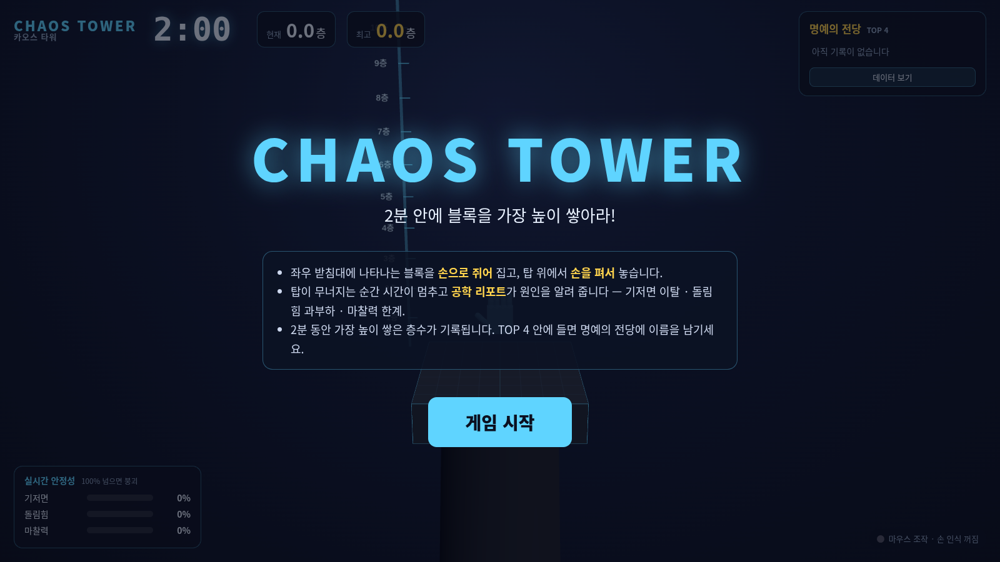
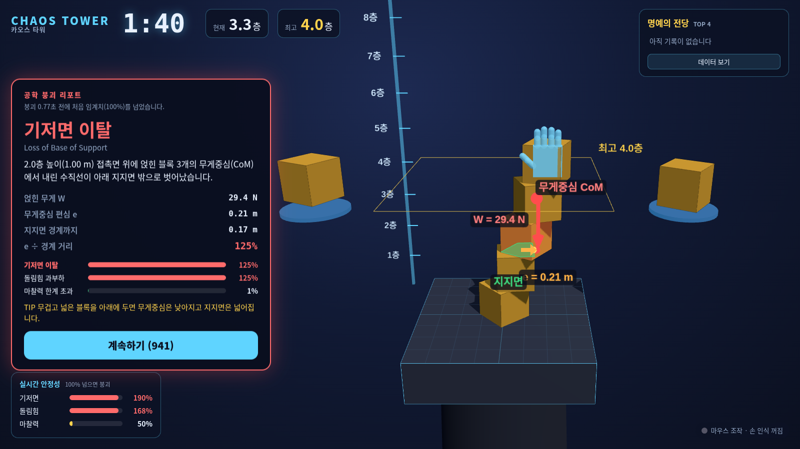
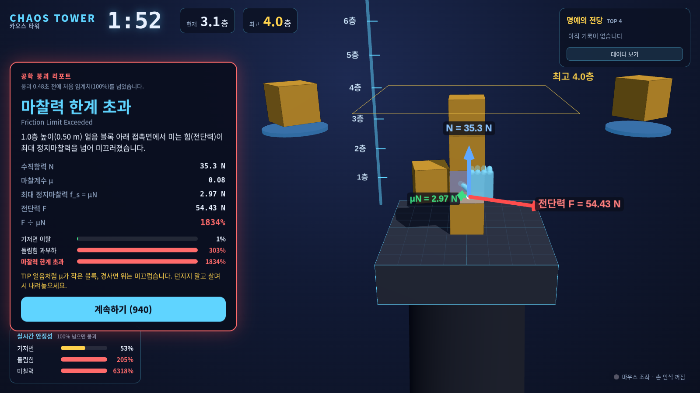

# EDU-contents · `laser-challenge` 브랜치 — 레이저 챌린지

이 저장소는 **브랜치마다 교육 게임 하나**를 둡니다.

| 브랜치 | 게임 | 설명 |
|---|---|---|
| `laser-challenge` | **레이저 챌린지** (LASER CHALLENGE) | 손을 거울처럼 기울여 레이저를 순서대로 맞히는 반사 원리 게임. **발사 모드**와 **라이브 모드** 두 가지 → [docs/LASER_CHALLENGE.md](docs/LASER_CHALLENGE.md) |
| `chaos-tower` (예정) | 카오스 타워 | 손으로 3D 블록을 쌓는 구조 안정성 게임 |

**바로 실행** (일반 PC · 노트북, 카메라가 없어도 마우스·키보드로 됩니다):

```
pip install -r requirements.txt
python server.py          # → 브라우저에서 http://localhost:8001/laser   (L 키: 라이브 모드)
```

자세한 설치·운영자 키·현장 점검은 [docs/LASER_CHALLENGE.md](docs/LASER_CHALLENGE.md) 를 보세요.
아래는 이 코드가 함께 쓰는 공통 서버·카메라 설명과, 같은 코드에 들어 있는 카오스 타워 설명입니다.

---

## 카오스 타워 (Chaos Tower) — 같은 코드에 들어 있는 다른 게임

> **레이저 챌린지**(손을 거울처럼 기울여 레이저를 맞히는 게임)도 같은 서버로 실행됩니다 → [docs/LASER_CHALLENGE.md](docs/LASER_CHALLENGE.md), 주소 `/laser`

깊이 카메라로 **손을 인식**해 3D 블록을 쌓는 2분 타임어택 부스 게임입니다.
탑이 무너지는 순간 시간이 멈추고, 세 가지 공학 원리(**기저면 이탈 · 돌림힘 과부하 · 마찰력 한계**) 중
가장 먼저 한계를 넘은 원인을 벡터 화살표와 숫자로 보여 주는 「공학 붕괴 리포트」가 뜹니다.



| 기저면 이탈 리포트 | 마찰력 한계 리포트 |
|---|---|
|  |  |

---

## 1. 준비물

| 항목 | 내용 |
|---|---|
| **컴퓨터** | 서버를 돌릴 컴퓨터 1대. 리눅스(Ubuntu 22.04, 젯슨), 윈도우 10/11(64비트), macOS(Apple Silicon). Python 3.9~3.13 |
| **깊이 카메라** | **Orbbec Gemini 335** (USB 3 포트). 같은 계열(Gemini 330 시리즈)은 동작할 가능성이 높음. 없으면 마우스로 플레이 |
| **화면** | WebGL이 되는 브라우저(크롬·엣지 권장). 서버 컴퓨터의 모니터나 **같은 네트워크의 다른 PC·태블릿** 브라우저 |
| **인터넷** | 설치할 때만 필요 (파이썬 패키지, 손 인식 모델). 실행 중에는 필요 없음 |

- **젯슨이 꼭 필요하지는 않습니다.** 위 컴퓨터 + 카메라면 됩니다. 젯슨에서는 GPU로 손 인식(약 22ms, 30fps)을 하고, GPU를 쓸 수 없는 환경에서는 자동으로 CPU를 씁니다
  (젯슨 CPU는 약 75ms라 느리지만, 일반 데스크톱·노트북 CPU는 더 빠릅니다).
- **실제로 테스트한 환경은 Jetson Orin Nano(JetPack 6, Ubuntu 22.04) + Gemini 335** 뿐입니다. 윈도우·macOS·일반 리눅스 PC 설치 방법은 패키지가 지원하는 범위에서 정리한 것입니다.
- 카메라는 한 프로그램만 쓸 수 있습니다. 다른 프로그램(예: Orbbec Viewer)이 카메라를 잡고 있으면 손 인식 없이 마우스로만 동작합니다.

## 2. 설치

### 리눅스 · 젯슨 · macOS
```bash
git clone <저장소 주소> chaos-tower
cd chaos-tower
./setup.sh          # 가상환경(.venv) + 패키지 + 손 인식 모델 (처음엔 몇 분)
```
리눅스에서 오르벡 카메라를 **처음** 쓰는 컴퓨터라면 USB 권한 규칙을 한 번 설치합니다 (sudo 필요):
```bash
sudo cp scripts/99-obsensor-libusb.rules /etc/udev/rules.d/
sudo udevadm control --reload-rules && sudo udevadm trigger
# 그다음 카메라를 뽑았다가 다시 꽂기
```
- 다른 파이썬을 쓰려면 `PYTHON=python3.11 ./setup.sh`
- `python3-venv`가 없는 시스템(젯슨 등)도 setup.sh가 알아서 pip를 받아 설치합니다
- macOS는 카메라(USB) 접근에 관리자 권한이 필요할 수 있습니다

### 윈도우 (PowerShell)
```powershell
git clone <저장소 주소> chaos-tower
cd chaos-tower
py -3.11 -m venv .venv
.venv\Scripts\python -m pip install -r requirements.txt
.venv\Scripts\python -m pip install --no-deps pyorbbecsdk2==2.1.2
mkdir models, data
curl.exe -L -o models\hand_landmarker.task https://storage.googleapis.com/mediapipe-models/hand_landmarker/hand_landmarker/float16/1/hand_landmarker.task
```
카메라가 잡히지 않으면 Orbbec `pyorbbecsdk` 문서의 윈도우 설정(메타데이터 등록)을 참고하세요.

> `pyorbbecsdk2`는 `--no-deps`로 설치합니다. 선언된 의존성(numpy<2, open3d, pygame 등)은 이 게임에 필요 없고 mediapipe와 버전이 충돌합니다.

## 3. 실행 · 종료

### 리눅스 · 젯슨 · macOS
```bash
./run.sh              # 서버 시작 (백그라운드). 손 인식 상태와 접속 주소를 알려 줌
./run.sh --no-camera  # 카메라 없이 마우스로만
./stop.sh             # 서버 종료
```

### 윈도우
```powershell
.venv\Scripts\python server.py              # 이 창을 닫거나 Ctrl+C로 종료
.venv\Scripts\python server.py --no-camera  # 마우스로만
```

### 접속
| 주소 | 내용 |
|---|---|
| `http://localhost:8001` | 게임 (서버 컴퓨터에서) |
| `http://<서버 IP>:8001` | 게임 (같은 네트워크의 다른 PC에서) |
| `http://<서버 IP>:8001/video` | 손 인식 카메라 화면 (관절·움직임 범위 확인) |

- 부스에서는 브라우저를 **전체 화면(F11)** 으로 띄우세요
- 로그: `data/server.log` (run.sh로 실행했을 때)

### 젯슨(리눅스)을 켤 때 자동으로 서버 시작 (선택)
`/etc/systemd/system/chaos-tower.service` (경로·사용자는 바꿔서):
```ini
[Unit]
Description=Chaos Tower
After=network-online.target

[Service]
User=jaeho
WorkingDirectory=/home/jaeho/jaeho_ws/src/chaos-tower/src/chaos_tower
Environment=GLOG_minloglevel=2
ExecStart=/home/jaeho/jaeho_ws/src/chaos-tower/src/chaos_tower/.venv/bin/python server.py
Restart=on-failure

[Install]
WantedBy=multi-user.target
```
```bash
sudo systemctl daemon-reload && sudo systemctl enable --now chaos-tower
```
(이렇게 띄운 서버는 `./stop.sh` 대신 `sudo systemctl stop chaos-tower`로 끕니다)

## 4. 플레이 방법

**2분 안에 블록을 가장 높이 쌓으세요.** 좌우 받침대에 나타나는 블록을 집어 가운데 플랫폼 위에 쌓습니다.

| 손 인식 | 마우스 | 동작 |
|---|---|---|
| 손 움직이기 | 마우스 이동 | 가상 손 위·아래·좌우 |
| 손을 화면(카메라) 쪽으로 내밀기 / 당기기 | 휠 / W·S | 손 앞뒤(깊이) |
| **주먹 쥐기 / 손 펴기** | 왼쪽 버튼 누르기 / 떼기 | 블록 잡기 / 놓기 |
| 버튼 위에 손 커서를 두고 주먹 | 클릭 | 게임 시작 · 계속하기 · 키패드 |
| - | Q · E | 잡은 블록 45° 회전 |
| - | V | 손 인식 카메라 화면 켜기/끄기 |
| - | Enter | 대기 화면에서 게임 시작 |

- 손이 카메라에 보이면 손 인식, 안 보이면 마우스로 조작합니다 (오른쪽 아래에 지금 조작 방식 표시)
- 손 아래 점선과 고리가 블록이 떨어질 지점을 보여 줍니다
- 게임 시작 카운트다운(3·2·1) 동안의 손 거리가 앞뒤 기준(가운데)이 됩니다. 손을 편하게 앞으로 내밀고 기다리세요
- 손을 잠깐(0.4초) 놓쳐도 잡고 있던 블록은 떨어지지 않습니다

### 게임 흐름
대기 → 3·2·1 → **120초 게임** ⇄ 붕괴 리포트 → TIME UP → (TOP 4 안이면) 이름 입력 → 대기

- **층수** = 탑 꼭대기 높이 ÷ 0.5m(정육면체 1개), 소수 첫째 자리. 1초 이상 버틴 높이만 최고 기록으로 인정
- **붕괴 리포트**가 떠 있는 동안 타이머는 멈춥니다. 10초 뒤 또는 「계속하기」로 이어서 하며, 남은 탑은 그대로입니다
- **블록 9종**: 정육면체 · 널빤지 · 넓은 판 · 기둥 · 원기둥 · 경사 블록(비대칭) · ㄴ자 블록 · 얼음(미끄러움) · 무거운 돌(3kg)
- **명예의 전당 TOP 4**에 들면 가상 키패드로 이름(영문·숫자 10자)을 입력합니다. 60초 동안 입력이 없으면 이름 없이 저장하고 처음으로 돌아갑니다

## 5. 공학 붕괴 분석

게임 중 매 순간(60Hz) 탑의 모든 접촉면에서 세 비율(**작용 ÷ 한계**)을 계산해 왼쪽 아래 「실시간 안정성」에 보여 줍니다. 100%를 넘으면 한계 초과입니다.

| 원리 | 계산 | 리포트 화살표 |
|---|---|---|
| **기저면 이탈** | 접촉면 위에 얹힌 블록들의 무게중심(CoM)이 지지면(위 블록 바닥면 ∩ 아래 물체 윗면) 밖으로 나갔는가 | 무게중심, 수직선, 무게 W, 편심 e, 지지면 |
| **돌림힘 과부하** | 하중 합력(무게 + 충격·밀기 같은 동적 접촉력)이 만드는 전도 모멘트 Στ = r × F 가 지지면의 저항 모멘트를 넘었는가 | 합력 F, 팔 r, 회전 방향 |
| **마찰력 한계** | 접촉면 방향으로 미는 힘(전단력) F 가 최대 정지마찰력 f_s = μ·N 을 넘었는가 | 수직항력 N, 전단력 F, μN |

- **붕괴 판정**: 다른 블록과 쌓여 있던 블록이 제자리에서 0.3m 또는 35° 이상 벗어나면
- **원인 판별**: 붕괴 직전 1.5초 안에서 100%를 가장 먼저(3틱 연속) 넘은 원리.
  천천히 기울어 무너지면 기저면 이탈, 블록을 떨어뜨린 충격은 「순간적으로 ○○%까지 치솟음」, 받치던 블록을 손으로 빼면 「지지 블록 제거」
- 화면은 그 원리가 처음 한계를 넘은 순간으로 **되감아** 화살표를 보여 줍니다
- 물리 엔진(cannon-es)의 기본 마찰 한계는 위에 쌓인 무게를 반영하지 않아, 실제 수직항력으로 μN을 적용하도록 보정했습니다

## 6. 기록 · 데이터 보기

기록은 `data/leaderboard.db`(SQLite 파일)에 저장되므로 **서버를 껐다 켜거나 컴퓨터를 재부팅해도 그대로** 남습니다.

- **모든 게임**이 기록됩니다: 이름(TOP 4에 들어 입력한 사람만), 최고 층, 최고 층을 처음 쌓은 시간(게임 시작 후 초), 붕괴 횟수, 마지막 붕괴 원인, 플레이 시각(초 단위)
- **명예의 전당은 TOP 4**만 보여 줍니다. 5위 아래로 밀려난 기록은 명예의 전당에서 자동으로 빠지지만 데이터에는 남습니다
- **데이터 보기** (명예의 전당 아래 버튼, 운영자용 · 마우스로만 눌림)
  - 지금까지 플레이한 사람 수 · 이름 남긴 사람 수 · 평균 · 역대 최고
  - 게임마다 한 줄씩 전체 기록, **CSV 저장**(엑셀에서 한글 그대로 열림)
  - **삭제**: 잘못된 기록을 데이터와 명예의 전당에서 모두 지웁니다 (되돌릴 수 없음). TOP 4 기록을 지우면 다음 기록이 올라옵니다
- **전부 초기화**: 서버를 끄고 `data/leaderboard.db`를 지운 뒤 다시 켜기 (필요하면 먼저 복사해 두세요)

## 7. 설정 (`config.yaml`)
바꾼 뒤에는 서버를 다시 켭니다 (`./stop.sh` → `./run.sh`).

| 키 | 기본값 | 설명 |
|---|---|---|
| `server.port` | 8001 | 접속 포트 |
| `camera.enabled` | true | false면 마우스로만 |
| `camera.width / height` | 640 / 360 | 컬러 해상도 (깊이는 카메라 하드웨어로 컬러에 정렬) |
| `camera.mirror` | true | 거울처럼 (관람객이 손을 오른쪽으로 → 화면에서도 오른쪽) |
| `hand.delegate` | gpu | 손 인식 장치. gpu가 안 되면 자동으로 cpu |
| `hand.max_hands` | 2 | 여러 손이 보이면 따라가던 손, 없으면 카메라에 가장 가까운 손 |
| `hand.grab_close / grab_open` | 1.20 / 1.40 | 손가락 펴짐 비율(끝-손목 ÷ 뿌리-손목)이 close보다 작으면 쥠, open보다 크면 폄. 주먹 ≈ 1.0, 편 손 ≈ 1.6 |
| `hand.box.half_w / half_h` | 0.28 / 0.18 | 손을 좌우 ±28cm, 위아래 ±18cm 움직이면 화면 끝에서 끝 (m) |
| `hand.box.center_x / center_y` | 0 / 0 | 손 움직임 범위의 가운데 (카메라 기준, m) |
| `hand.menu_gain` | 1.25 | 메뉴 버튼·키패드에서는 커서를 이만큼 더 크게 움직임 |
| `hand.depth_ref / depth_range` | 0.7 / 0.25 | 기본 손 거리와 앞뒤 범위 (m). 기준은 게임마다 카운트다운 때 다시 맞춤 |

### 부스에서 위치 맞추기
1. 카메라를 화면 위나 아래에 관람객을 향하게 두고, 게임 화면에서 **V**(또는 `/video`)로 카메라 화면을 봅니다
2. 관람객이 설 자리를 정합니다 (손이 카메라에서 0.5~1m 정도). 노란 상자 = 지금 손 거리에서 손을 움직일 범위.
   카메라에 가까이 서면 손가락까지 화면 안에 남도록 상자가 자동으로 줄어듭니다
3. 화면 끝까지 손이 잘 안 가면 `hand.box.half_w / half_h`를 줄이고, 너무 예민하면 늘립니다. 메뉴만 불편하면 `hand.menu_gain`을 올립니다
4. 쥠/폄이 잘 안 바뀌면 `/video` 화면 위쪽 `open=` 값을 보며 `grab_close / grab_open`을 조정합니다

## 8. 문제 해결

| 증상 | 확인할 것 |
|---|---|
| 오른쪽 아래 「손 인식 꺼짐」 | 카메라가 USB 3에 꽂혀 있는지, 다른 프로그램이 카메라를 쓰는지, 리눅스는 udev 규칙(2장). `data/server.log`의 `[hand]` 줄 |
| 손 인식이 느림 (fps 낮음) | 로그에 `GPU 델리게이트 실패`가 있으면 CPU로 도는 중. 젯슨은 `nvpmodel -q`로 최대 성능 모드(MAXN)인지 확인 |
| 손이 화면 끝까지 안 감 / 키패드가 불편 | 7장 「위치 맞추기」 |
| 블록을 놓으려 해도 안 놓아짐 | 손을 쫙 펴기. 계속되면 `grab_open`을 낮추기 |
| 다른 PC에서 접속 안 됨 | 같은 네트워크인지, 방화벽에서 8001 포트 허용 |
| 서버가 안 켜짐 | `data/server.log` 마지막 줄, 8001 포트를 다른 프로그램이 쓰는지 (`server.port` 변경) |
| 카메라가 USB에서 끊김 | 전원이 있는 USB 허브 사용 |

## 9. 구조

| 파일 | 역할 |
|---|---|
| `server.py` | Flask 서버: 게임 파일, 기록 API(SQLite), 손 인식 스트림 |
| `hand.py` | 손 인식 스레드: 오르벡 컬러+깊이 → MediaPipe 손 관절 21점 → 화면 위치·거리·쥠/폄 |
| `camera.py` | 오르벡 컬러 + 하드웨어 정렬 깊이 |
| `config.yaml` | 설정 |
| `setup.sh`, `requirements.txt` | 설치 |
| `run.sh`, `stop.sh` | 실행 · 종료 |
| `public/index.html`, `style.css` | 화면 (3D 캔버스 + HUD · 명예의 전당 · 리포트 · 키패드 · 데이터 보기) |
| `public/vendor/` | three.js 0.186.1, cannon-es 0.20.0 (인터넷 없이 동작하도록 포함) |
| `src/main.js` | 게임 진입점: 장면, 게임 루프, 게임 흐름, 가상 손, 카메라 |
| `src/physics.js` | 물리: 블록 종류 · 메시 풀, 잡기/놓기, 접촉력 기록, μN 마찰 보정 |
| `src/analyzer.js` | 붕괴 분석, 리포트 문구, 3D 벡터 화살표 |
| `src/sensor.js` | 입력: 손 인식(One Euro 필터) + 마우스 |
| `src/database.js` | 기록 API 호출 |
| `src/ui.js` | HUD, 리포트 팝업, 결과 화면, 키패드, 데이터 보기 |
| `scripts/99-obsensor-libusb.rules` | 리눅스 오르벡 USB 권한 규칙 (Orbbec SDK 배포본) |
| `tests/` | 헤드리스 크롬 테스트 |

### 기록 DB (`data/leaderboard.db`)
- `plays(id, player_name, max_floor, best_time_s, collapses, failure_reason, duration_s, created_at)` — 모든 게임
- `leaderboard(id, player_name, max_floor, failure_reason, created_at)` — TOP 4. 기록이 바뀔 때마다 `plays`에서 다시 만듦 (이름 있는 기록만)

### API
| API | 설명 |
|---|---|
| `GET /api/leaderboard` | 명예의 전당 TOP 4 |
| `POST /api/plays` | 게임 결과 저장 → `{id, rank, qualifies}` |
| `POST /api/plays/<id>/name` | TOP 4 기록에 이름 붙이기 |
| `GET /api/plays` · `/api/plays.csv` | 모든 기록 + 요약 · CSV |
| `DELETE /api/plays/<id>` | 기록 삭제 |
| `GET /hand` · `/api/hand` · `/video` | 손 인식 스트림(SSE, 약 30fps) · 현재 값 · 미리보기(MJPEG) |

## 10. 테스트 (헤드리스 크롬, 서버 실행 중일 때)
```bash
# 물리 · 붕괴 분석 시나리오 7개 (곧게 쌓기, 계단, 얼음 밀기, 외팔보, 블록 빼기, 경사+얼음, 블록 32개 부하)
chromium --headless=new --no-sandbox --disable-gpu --virtual-time-budget=120000 \
  --dump-dom http://localhost:8001/tests/sim_test.html
# 게임 흐름 스크린샷: stage = title | report | push | drop | keypad | result | data (&clean: 명예의 전당 가림)
chromium --headless=new --no-sandbox --use-angle=swiftshader --enable-unsafe-swiftshader --window-size=1600,900 \
  --virtual-time-budget=60000 --screenshot=shot.png "http://localhost:8001/tests/flow_test.html?stage=report"
```
- `keypad`, `result` 단계는 실제 기록을 남기므로 끝나면 데이터 보기에서 지우세요
- 게임 주소에 `?test`가 붙으면 손 인식 스트림에 연결하지 않습니다 (열린 스트림이 있으면 헤드리스의 가상 시간이 멈춤)
- 브라우저 콘솔 디버그: `chaos.state`, `chaos.physics`, `chaos.analyzer`, `chaos.sensor.hand.info`, `chaos.advance(초)`

## 11. 사용한 오픈소스
| 이름 | 용도 | 라이선스 |
|---|---|---|
| [three.js](https://threejs.org) | 3D 그래픽 | MIT |
| [cannon-es](https://github.com/pmndrs/cannon-es) | 물리 엔진 | MIT |
| [MediaPipe](https://ai.google.dev/edge/mediapipe) + Hand Landmarker 모델 | 손 인식 | Apache-2.0 |
| [pyorbbecsdk](https://github.com/orbbec/pyorbbecsdk) | 오르벡 카메라 | Apache-2.0 |
| [Flask](https://flask.palletsprojects.com) | 웹 서버 | BSD-3-Clause |
